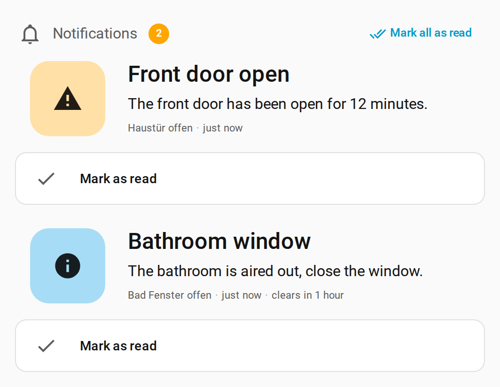

# Clearable Notifications

Stateful, clearable notifications for Home Assistant: raise them from automations, clear them when the condition resolves, and show them on a dashboard card.

[](https://my.home-assistant.io/redirect/hacs_repository/?owner=poesterlin&repository=ha-clearable-notifications&category=integration)
[](https://github.com/hacs/integration)

## Installation

### HACS (custom repository)

1. In Home Assistant, open HACS and choose the three-dot menu, then **Custom repositories**.
2. Add `https://github.com/poesterlin/ha-clearable-notifications` with category **Integration**.
3. Search for "Clearable Notifications", download it and restart Home Assistant.
4. Go to **Settings > Devices & services > Add integration** and add "Clearable Notifications".

### Manual

1. Download `clearable_notifications.zip` from the latest release.
2. Extract it into `<config>/custom_components/clearable_notifications/`.
3. Restart Home Assistant and add the integration as above.

Requires Home Assistant 2025.10.0 or newer.

## Screenshot

<picture>
  <source media="(prefers-color-scheme: dark)" srcset="assets/card-dark.png">
  <source media="(prefers-color-scheme: light)" srcset="assets/card-light.png">
  
</picture>

## Setup

1. Go to **Settings > Devices & services > Add integration** and add **Clearable Notifications**. This creates one hub; only one is allowed. The form asks for the default auto-clear time per severity (info is prefilled with 1 hour; leave a field empty or at 0 to never auto-clear that severity). Change the defaults later with **Configure** on the integration page; Home Assistant reloads the integration and the new defaults apply from the next activation.
2. On the integration page choose **Add notification** and fill in the form:

| Field | Description |
| --- | --- |
| Name | Required. Becomes the entity name, e.g. "Freezer too warm" gives `binary_sensor.freezer_too_warm`. |
| Default severity | `info`, `warning` or `critical`. Can be overridden on each activation. |
| Title | Optional. Supports templates. |
| Message | Required. Supports templates, e.g. `Freezer at {{ states('sensor.freezer_temperature') }} °C`. Variables passed to the action are available too. |
| Icon | Optional. Defaults to an icon matching the current severity. |
| Auto-clear after | Optional. Clears the notification this long after its last activation. Useful as a heartbeat. Overrides the hub defaults; leave empty to use the default for the severity of the current activation, or enter 0 to never auto-clear. |
| Also show in the Home Assistant notification drawer | Mirrors the notification to the sidebar bell. |

To change a notification later, open the integration page, use the pencil (reconfigure) menu on its entry and save. Home Assistant reloads the integration; the current state of each notification is kept. The entity ID does not change when you rename a notification, only its friendly name.

## Entities

### Notifications

Each notification is a binary sensor, `binary_sensor.<name>`. It is `on` (shown as **Active**) while the notification is raised and `off` (**Clear**) otherwise. State is restored after a restart.

| Attribute | Description |
| --- | --- |
| `severity` | `info`, `warning` or `critical`. |
| `severity_rank` | 1, 2 or 3 for `info`, `warning`, `critical`. Handy for numeric comparisons. |
| `title` | Rendered title, or `null`. |
| `message` | Rendered message. |
| `acknowledged` | `true` once someone has acknowledged the active notification. |
| `activated_at` | When it last went from clear to active. Not changed by updates. |
| `updated_at` | When it was last activated or updated. |
| `cleared_at` | When it was last cleared. |
| `acknowledged_at` | When it was acknowledged, or `null`. |
| `auto_clear_at` | When it will clear itself, or `null`. |
| `activation_count` | How often it went from clear to active. Updates of an active notification do not count. |
| `notification_id` | Stable ID of the notification. The notification drawer mirror uses `clearable_notifications_<notification_id>`. |

### Summary sensors

Both belong to the "Clearable Notifications" device.

| Entity | State | Attributes |
| --- | --- | --- |
| `sensor.clearable_notifications_active` | Number of active notifications. | `unacknowledged` (count), `info`, `warning`, `critical` (counts per severity), `notifications` (list of active notifications, most severe first, then newest first). Each item has `entity_id`, `name`, `title`, `message`, `severity`, `acknowledged`, `activated_at`. |
| `sensor.clearable_notifications_highest_severity` | `none`, `info`, `warning` or `critical`. | `unacknowledged`: the highest severity among notifications that are not acknowledged yet (also `none` if there are none). |

## Actions

All four actions target `binary_sensor` entities of this integration. Use `entity_id: all` to apply an action to every notification.

| Action | Fields | Description |
| --- | --- | --- |
| `clearable_notifications.activate` | `message`, `title`, `severity`, `variables` (all optional) | Raises the notification, or updates it if it is already active. |
| `clearable_notifications.clear` | none | Clears the notification because its condition is gone. Does nothing if it is already clear. |
| `clearable_notifications.acknowledge` | none | Marks an active notification as seen. Does nothing if it is clear. |
| `clearable_notifications.set_active` | `active` (required), plus the fields of `activate` | Activates when `active` is true, clears when false. Meant for templates. |

Field details:

- `message` and `title` override the configured values. They are used as-is, not rendered as templates again, because automations already render their own templates.
- `severity` overrides the default severity: `info`, `warning` or `critical`.
- `variables` is a mapping available to the configured title and message templates, e.g. `variables: {temp: 3}` for `Freezer at {{ temp }} °C`.
- If a configured template fails to render, the action fails with an error and the notification is not changed.

### Acknowledging

Acknowledging means "I have seen this". The notification stays active until it is cleared; only `acknowledged` changes. You can acknowledge from the card, with the `acknowledge` action, or by dismissing the mirrored notification in the sidebar.

- Activating an already active notification again with the same or a lower severity keeps it acknowledged.
- Activating it with a higher severity (escalation) resets `acknowledged` so it asks for attention again.
- Clearing and activating it again also starts unacknowledged.

### Events

Every change fires a `clearable_notifications_event` event. The event data has `entity_id`, `type`, `severity`, `title` and `message`. `type` is one of `activated`, `updated` (activated again while active), `cleared` (by action or auto-clear) or `acknowledged`.

## Automation examples

Replace the entity IDs with your own.

### Freezer too warm

Raise the notification after 10 minutes above -12 °C and clear it when the freezer is below -15 °C. The notification's message is `Freezer at {{ temp }} °C`.

```yaml
automation:
  - alias: Freezer notification
    triggers:
      - trigger: numeric_state
        entity_id: sensor.freezer_temperature
        above: -12
        for: "00:10:00"
        id: warm
      - trigger: numeric_state
        entity_id: sensor.freezer_temperature
        below: -15
        id: cold
    actions:
      - choose:
          - conditions:
              - condition: trigger
                id: warm
            sequence:
              - action: clearable_notifications.activate
                target:
                  entity_id: binary_sensor.freezer_too_warm
                data:
                  severity: warning
                  variables:
                    temp: "{{ states('sensor.freezer_temperature') }}"
          - conditions:
              - condition: trigger
                id: cold
            sequence:
              - action: clearable_notifications.clear
                target:
                  entity_id: binary_sensor.freezer_too_warm
```

### One automation with set_active

`set_active` activates or clears depending on a template, so a single trigger is enough.

```yaml
automation:
  - alias: Freezer notification (set_active)
    triggers:
      - trigger: state
        entity_id: sensor.freezer_temperature
    actions:
      - action: clearable_notifications.set_active
        target:
          entity_id: binary_sensor.freezer_too_warm
        data:
          active: "{{ states('sensor.freezer_temperature') | float(-20) > -12 }}"
          variables:
            temp: "{{ states('sensor.freezer_temperature') }}"
```

### Heartbeat with auto-clear

Give the notification an **Auto-clear after** of, say, 2 minutes. Re-activating it every minute keeps it alive; when the source stops (the automation, or Home Assistant itself), it clears on its own.

```yaml
automation:
  - alias: Garage door open heartbeat
    triggers:
      - trigger: time_pattern
        minutes: "/1"
    conditions:
      - condition: state
        entity_id: binary_sensor.garage_door
        state: "on"
    actions:
      - action: clearable_notifications.activate
        target:
          entity_id: binary_sensor.garage_door_open
```

### React to an acknowledgement

```yaml
automation:
  - alias: Stop alarm siren when acknowledged
    triggers:
      - trigger: event
        event_type: clearable_notifications_event
        event_data:
          type: acknowledged
          entity_id: binary_sensor.freezer_too_warm
    actions:
      - action: switch.turn_off
        target:
          entity_id: switch.siren
```

Leave out `entity_id` under `event_data` to react to every notification.

## Templates

```jinja
# Number of active notifications
{{ states('sensor.clearable_notifications_active') }}

# All active notifications (list of dictionaries)
{{ state_attr('sensor.clearable_notifications_active', 'notifications') }}

# Names of unacknowledged ones
{{ state_attr('sensor.clearable_notifications_active', 'notifications')
   | rejectattr('acknowledged') | map(attribute='name') | list }}

# Is anything critical and not yet acknowledged?
{{ is_state_attr('sensor.clearable_notifications_highest_severity', 'unacknowledged', 'critical') }}
```

As a condition:

```yaml
conditions:
  - condition: state
    entity_id: sensor.clearable_notifications_highest_severity
    state: critical
```

## Card

The integration serves and registers the card itself, so there is no dashboard resource to add. Add **Clearable Notifications** from the card picker, which includes a visual editor, or use YAML. The recommended setup:

```yaml
type: custom:clearable-notifications-card
title: Benachrichtigung
hide_when_empty: true
```

With `hide_when_empty` the heading disappears together with the notifications, so this one card can replace a separate heading card plus a conditional card.

### Layouts

`layout: large` (default) shows:

- an optional heading with an icon (`title`, `icon`);
- no card background: the card sits directly on the dashboard;
- per notification, a large severity-tinted icon tile with a big title and message, plus the time and the auto-clear countdown;
- a full-width read button below each unread notification. With `read_action: auto` (default) it clears info notifications and acknowledges warning and critical ones;
- a **Mark all as read** button when two or more notifications are unread;
- read notifications are dimmed and carry a "Read" marker.

`layout: compact` is the previous list in a regular card, with acknowledge and clear icon buttons per notification.

The card's text follows the Home Assistant language (English and German). Tapping a notification opens its more-info dialog. Notifications are sorted by severity, then unread first, then newest first.

A fuller example:

```yaml
type: custom:clearable-notifications-card
layout: large
title: Notifications
icon: mdi:bell-outline
entities:
  - binary_sensor.freezer_too_warm
  - binary_sensor.laundry
min_severity: info
read_action: auto
show_acknowledged: true
show_cleared: false
hide_when_empty: true
```

| Option | Default | Description |
| --- | --- | --- |
| `layout` | `large` | `large` or `compact`. |
| `title` | `""` | Heading. Without a title no heading is shown. |
| `icon` | `mdi:bell-outline` | Icon next to the heading (large layout). |
| `entities` | `[]` | Notifications to show. An empty list shows all notifications of this integration. |
| `min_severity` | `info` | Hide notifications below this severity: `info`, `warning` or `critical`. |
| `read_action` | `auto` | What the read button does: `auto` (clear info, acknowledge warning and critical), `acknowledge` or `clear`. |
| `read_icon` | `mdi:check` | Icon of the read button. |
| `show_acknowledged` | `true` | Show active notifications that are already acknowledged (read). |
| `show_cleared` | `false` | Also show recently cleared notifications under a "Recently cleared" heading (the last 5). |
| `show_actions` | `true` | Show the read buttons (large) or the acknowledge and clear buttons (compact). |
| `show_time` | `true` | Show the time of the notification. |
| `hide_when_empty` | `false` | Hide the whole card, including the heading, when there is nothing to show. |
| `empty_message` | `""` | Text shown when nothing is active. Empty uses the localized "No notifications". |
